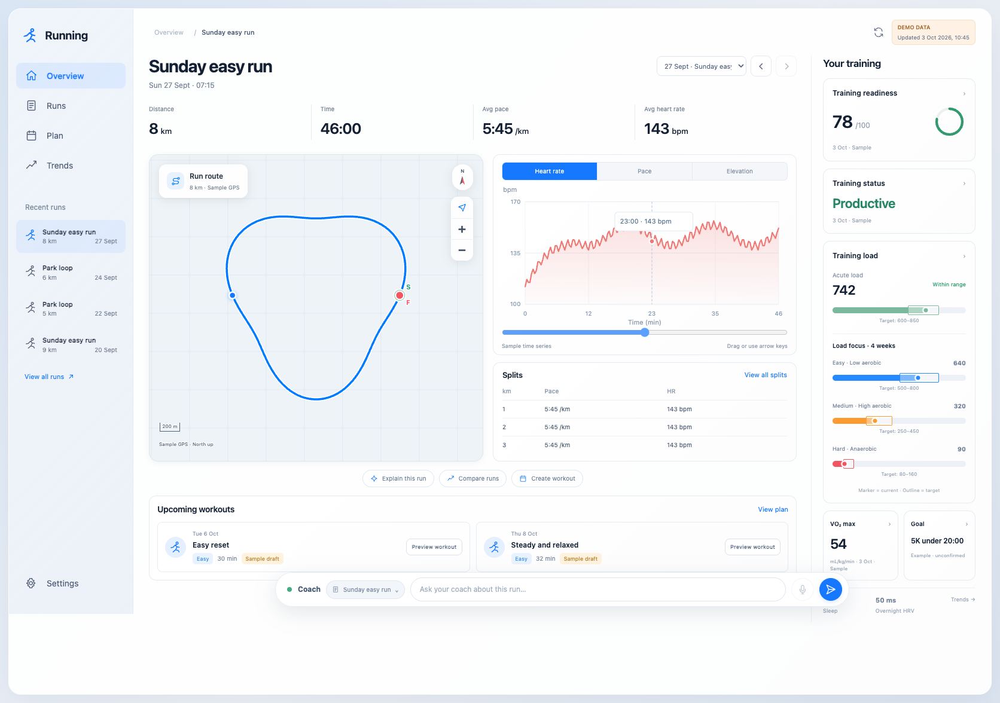

# Running · AI Running Coach for Garmin

An open-source, local-first AI running coach. It reads your Garmin data through an existing [Garmin MCP server](https://github.com/Taxuspt/garmin_mcp), lets Claude (or Codex) review your training against your own goal, and shows everything in a macOS-inspired dashboard on `localhost`. Approved workouts can be sent to Garmin Connect and on to your watch.



*Screenshot uses built-in synthetic sample data.*

## What it does

* **Overview workspace**: your latest run with an interactive route map, linked heart-rate/pace/elevation charts, splits and upcoming workouts.
* **Training signals**: readiness, training status, acute load and load focus with Garmin's target ranges, VO₂ max, sleep, HRV and resting HR, with clear missing-data states.
* **Coach chat**: ask about a run or trend. Claude answers from your saved data and cites the activities it used.
* **Weekly plan**: an evidence-based draft week that respects your running days, other training and constraints.
* **Workouts to your watch**: reviewed workouts become structured Garmin workouts, with duplicate prevention and read-back verification.
* **Coach memory**: notes and insights you explicitly save carry over between conversations, and you can edit or delete them.
* **Optional daily runner**: a local scheduled refresh and planning review. It is off until you enable it.

Everything runs on your machine. Your data stays in the git-ignored `data/` folder.

## How it works

```
Watch → Garmin Connect → Garmin MCP server → coach (Claude Code / Codex / Claude API)
                                                   │
                         validated JSON snapshots in data/ → localhost dashboard
                                                   │
          approved workout → Garmin Connect calendar → Send to Device → watch
```

The app itself uses only the Python standard library. Garmin access goes through a pinned version of [Taxuspt/garmin_mcp](https://github.com/Taxuspt/garmin_mcp/tree/cfc5d799ab0f165e837f1188a1d093c65838aaf7) installed in its own virtual environment.

## Quick start (sample data, no accounts)

Requirements: macOS or Linux, Python 3.12+.

```bash
git clone https://github.com/kingarthur321/GarminCoach.git
cd GarminCoach
./launch.sh
```

Open **http://127.0.0.1:8765**. The first launch creates an unconfirmed example profile and clearly labeled sample data. Stop it with Ctrl-C, or use `./launch.sh --port 8767` for another port.

## Enable the Claude coach chat

```bash
cp .env.example .env
```

Paste your [Anthropic API key](https://console.anthropic.com/) after `ANTHROPIC_API_KEY=` in `.env`, then restart `./launch.sh`. Open the coach with the floating bar or Cmd/Ctrl+K. API usage is billed to your Anthropic account.

## Connect your Garmin account

```bash
python3 scripts/install_mcp.py          # installs the pinned MCP server and checks its hash
./.venv-mcp/bin/garmin-mcp-auth         # you type email, password and MFA yourself
python3 scripts/configure_client.py claude   # or: codex
```

Restart Claude Code or Codex in this folder and paste the **first session prompt** from [START_HERE.txt](START_HERE.txt). The agent helps you confirm your real profile, imports your recent training and prepares a first draft week. Credentials stay in the MCP authentication tool and its token store (`~/.garminconnect`), never in this project.

Full details: [launch and troubleshooting](docs/LAUNCH.md) · [coaching procedure](COACHING.md) · [watch sync](docs/WATCH_SYNC.md).

## Safety by design

* **Write policy**: `draft_only` (the default) never writes to Garmin. `selected_workouts` writes only the exact workout revisions you approve. `automatic` must be chosen explicitly.
* **No duplicates**: every workout carries a unique marker. Uncertain writes are reconciled read-only before any retry.
* **Honest data**: measured Garmin data, your statements, derived numbers and AI suggestions are labeled separately. Missing values stay missing, and imported activity names are treated as data, never as instructions.
* **Local only**: the dashboard binds to `127.0.0.1` and serves only allowlisted endpoints. GPS samples are never sent to the AI. Map tiles come from OpenStreetMap, and an offline map mode is available.

## Make it yours

This project is meant to be forked and iterated on, ideally together with a coding agent:

* **Coaching style**: edit [prompts/coach-chat.md](prompts/coach-chat.md) and [prompts/coach-plan-api.md](prompts/coach-plan-api.md). The default takes inspiration from [publicly described principles](docs/COACH_PHILOSOPHY.md) of controlled, consistent training.
* **Build spec**: [BUILD_SPEC.md](BUILD_SPEC.md) and [AGENTS.md](AGENTS.md) describe the product and rules for Claude Code and Codex. Ask your agent to extend them.
* **Model**: set `ANTHROPIC_MODEL` in `.env` (default `claude-sonnet-5-5`).

Ideas and pull requests are welcome; see [CONTRIBUTING.md](CONTRIBUTING.md).

## Project layout

| Path | Contents |
| --- | --- |
| `coach/` | Normalization, validation, storage, Garmin workout logic, Claude API worker, local server |
| `web/` | Dashboard (plain HTML, CSS and JavaScript) |
| `scripts/` | MCP installer, client setup, Garmin importers, QA and release tools |
| `prompts/`, `schemas/` | Editable coach prompts and the JSON schemas their output must match |
| `tests/` | Fixture and mock tests; no account needed |
| `docs/` | Launch guide, verification, feature guides and synthetic evidence |
| `data/` | Your private state (created on first launch, ignored by git) |

## Tests

```bash
python3 -m unittest discover -v
node tests/map-geometry.cjs
.venv-mcp/bin/python scripts/verify_mcp_contract.py   # after install_mcp.py
```

The tests use synthetic fixtures and mocked Garmin responses. [docs/VERIFICATION.md](docs/VERIFICATION.md) separates fixture checks from the real-account checks done during development.

## Limitations and disclaimer

* Not affiliated with or endorsed by Garmin. Garmin access depends on an unofficial community MCP server and Garmin Connect's private APIs, which can change or break without notice. Use your own account at your own risk.
* This is not medical advice. Wearable signals are indicators, not diagnoses, and AI suggestions can be wrong. Listen to your body and consult a professional when needed.
* The optional scheduler only runs while your computer is on.
* Nutrition, smart scales, mobile apps, hosting and multiple users are out of scope.

## License

[MIT](LICENSE). The Garmin MCP server is a separate MIT-licensed project by its own authors and is downloaded at install time; it is not included in this repository.
