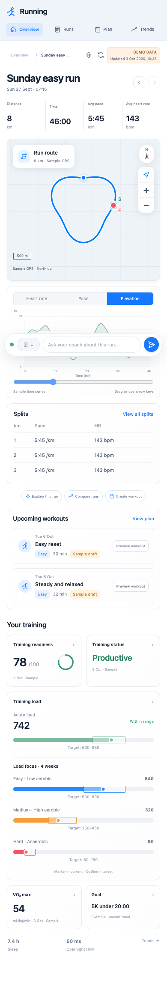

# Verification evidence

Built and verified in October 2026 on macOS arm64 with Python 3.14.6, Codex CLI 0.159.3 and Claude Code 2.1.231. All account-response test data in this repository is synthetic unless a row says otherwise. Evidence produced from the author's own Garmin account stays private; only its outcome is summarized here.

## Reproducible in this repository (fixtures and mocks)

| Check | Result | Evidence and limits |
| --- | --- | --- |
| Bootstrap/local launch | Passed | Unconfirmed example profile, valid fixture snapshot, 127.0.0.1:8765 server |
| Behavioral tests | Passed | Fixture/mock unit tests for normalization, validation, persistence, profile confirmation, write policy, duplicate prevention, uncertain-write recovery, memory, planned runs, routes and runner safeguards. [Results](evidence/unit-checks.json) |
| Desktop/mobile dashboard | Passed with fixtures | Chrome/Playwright at 1672px/1440px/390px: linked chart/route, run selection, cumulative splits, comparisons, load geometry/colors, previews/navigation. [Browser checks](evidence/browser-checks.json), screenshots below |
| Profile, feedback, date persistence | Passed | Reload and saved endpoint state checked in a disposable store; review flag verified |
| Imported HTML escaping | Passed | HTML/event-handler strings displayed as text; no element/handler ran |
| Athlete memory | Passed | [Memory checks](evidence/memory-checks.json): same-origin create/edit/delete, bounded chat/planning context and desktop/mobile UI. [Live synthetic Claude check](evidence/memory-live-check.json) recalled a saved statement |
| Chat proposal to workout | Passed with mocks | [Browser check](evidence/chat-workout-checks.json): chat, exact approval, separate send, mock Connect readback, simulated watch report and mobile layout |
| Claude API conversation | Passed with live API and synthetic data | [Live check](evidence/claude-api-check.json) returned a schema-valid answer with a valid activity reference and no Garmin operation |
| Actual MCP install/tools | Passed without account | Pinned Taxuspt commit, actual stdio initialize/tools/list; [schemas](mcp-tools.json) |
| Actual MCP response contract | Passed with synthetic API | Actual tool functions/curators match normalized reads and compiled workouts; [results](evidence/mcp-contract-checks.json) |
| Geographic map geometry | Passed | Mercator reference/inverse, responsive fit, equal axis scale, GPS gaps and dateline; `tests/map-geometry.cjs` |
| Street tile/route alignment | Passed with mocks | Known coordinate/tile center, shared pan/zoom and failure fallback; [map checks](evidence/map-checks.json), zero provider requests |
| Runner safeguards | Passed with fixtures/mocks | Lock, no-change preservation, valid/invalid output, timeout and disabled scheduling |
| Clean archive | Passed | `scripts/package_release.py`: allowlisted files, hash manifest, fresh extraction init/demo/validate |

## Verified by the author with a real account (details private)

These checks passed once against a real Garmin Connect account and a real Garmin watch during development. Your own account must be checked separately; nothing here proves that your login, data or device will behave the same.

* Terminal authentication through the MCP tool, with the agent never reading token contents.
* Bounded activity, wellness and training-signal import (42 days of activities and training status, 14 days of sleep/HRV/resting HR), plus recorded routes, series and splits.
* A confirmed profile, a validated evidence-based draft week and a Claude API planning review.
* Guarded publication of individually selected structured workouts, with read-back of steps and calendar date in Garmin Connect.
* A workout appearing on the watch, reported by the user. Connect scheduling alone is never treated as device evidence.

## Commands

```bash
python3 -m unittest discover -v
python3 -m coach validate
node --check web/app.js
node --check web/map.js
node tests/map-geometry.cjs
.venv-mcp/bin/python scripts/verify_mcp_contract.py
node scripts/qa-dashboard.cjs
node scripts/qa-map.cjs
python3 scripts/package_release.py
```

Account and device results need direct evidence; fixture tests must not be relabeled as live verification. Keep screenshots or JSON from your own account under `data/verification/`, which is ignored by git.




Other pages: [Runs](evidence/dashboard-runs-fixture-desktop.png), [Plan](evidence/dashboard-plan-fixture-desktop.png), [Trends](evidence/dashboard-trends-fixture-desktop.png), [Settings](evidence/dashboard-settings-fixture-desktop.png). Each also has a synthetic mobile screenshot under evidence/.
